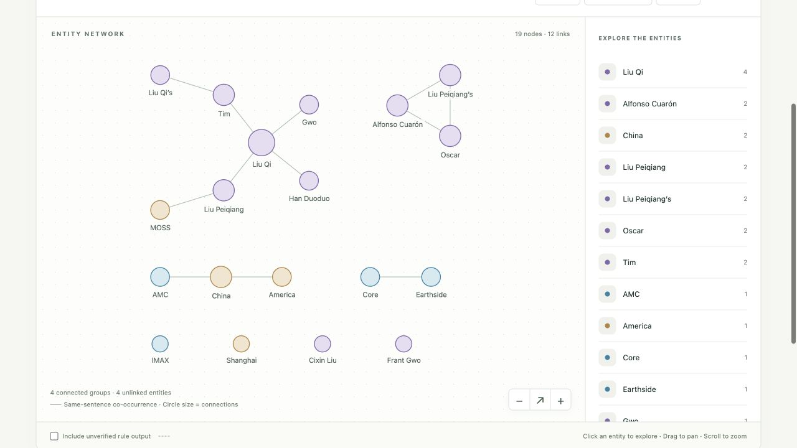
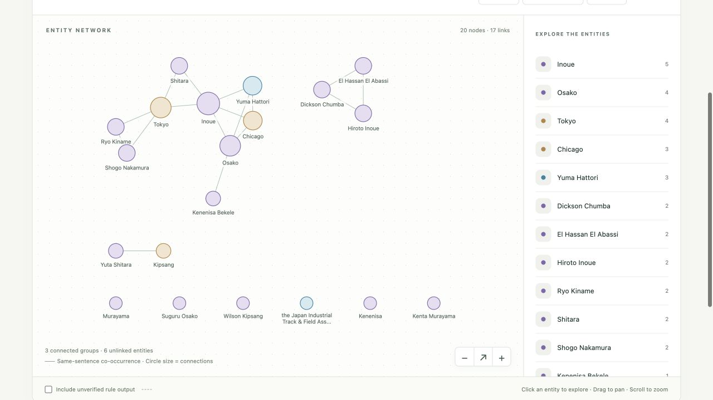
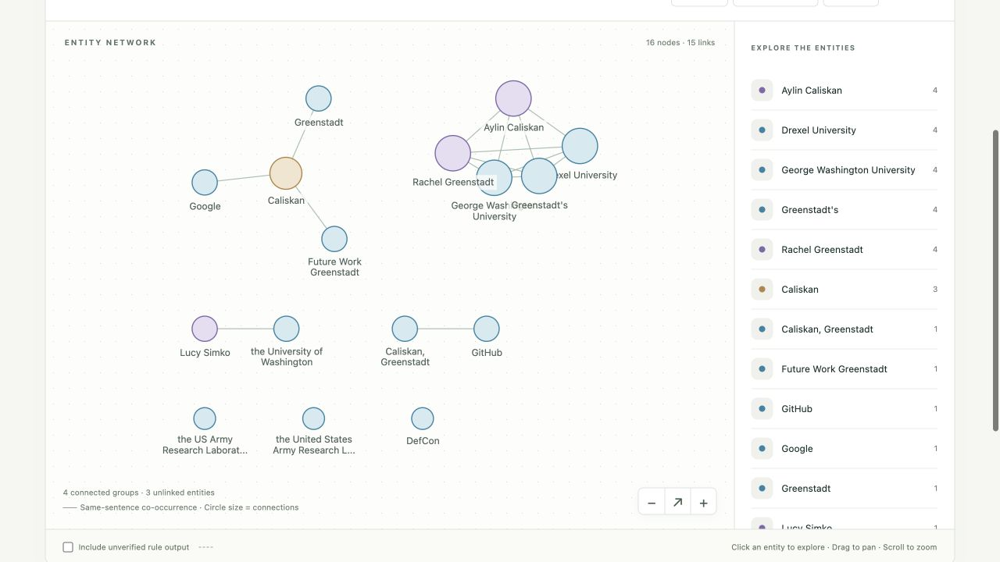

# News Graph

[](#how-to-use)
[](#how-to-use)
[](#how-to-use)
[](#edit-the-visualization)
[](web/vendor/README.md)
[](LICENSE)

Extract key information from English text and explore it in an interactive graph. Inspired by [TextGrapher](https://github.com/liuhuanyong/TextGrapher).

# Project Introduction

News Graph uses spaCy and TextRank to extract entities, rule-based relationships, keywords, and frequent words. The visualization uses **AntV G6 5.1.1 with plain JavaScript**. There is no npm install, TypeScript compilation, or frontend build step.

Open the included `graph_show.html` directly in a modern browser to try the demo. Each generated HTML contains its JavaScript, styles, graph data, and supplied source text, so you can move it or share it without a server or internet connection. Be aware that sharing the HTML also shares the source text.

## The Wandering Earth — default output

19 entities and 12 links, including the network around Liu Qi and Liu Peiqiang.



See [two more example outputs](#additional-example-outputs) at the end of this README.

# How to use

Install a current version of [uv](https://docs.astral.sh/uv/getting-started/installation/), then run these commands from the repository root:

```sh
uv sync --locked
uv run python main.py
```

uv manages the project environment in `.venv` and uses Python **3.14.7**, pinned in `.python-version`. A current uv can download Python automatically if needed. Python 3.14 is the supported version range; other minor versions have not been validated.

`pyproject.toml` declares the dependencies and `uv.lock` pins their resolved versions and artifact hashes, including the **`en_core_web_lg` 3.8.0** model from spaCy's official GitHub release. The first sync needs internet access and downloads a large model, so it may take a while. No separate `spacy download` command or environment activation is needed. After installation, text analysis and generated HTML work offline.

To analyze your own text, use the existing API in a Python script and run it with `uv run python your_script.py`:

```python
from news_graph import NewsMining
content = 'Input you text here'
Miner = NewsMining()
Miner.main(content)
```

This writes `graph_show.html` in the current working directory, replacing any existing file with that name. Open it in your browser. Run `uv run python main.py` to regenerate the supplied example.

[`main.py`](main.py) contains three articles, but its final call is **`Miner.main(content1)`**. Running `uv run python main.py` therefore processes only the first article; it does not process or combine all three.

## Manage dependencies

Use `uv add package-name` and `uv remove package-name` to change dependencies. To update compatible versions, run `uv lock --upgrade`, then `uv sync --locked` and the tests below. Keep `pyproject.toml`, `.python-version`, and `uv.lock` in version control; `.venv` is local and ignored.

The English model is pinned separately: upgrading spaCy to a new minor version may require changing both the model version and its URL in `pyproject.toml`, then regenerating the lock file. Do not install the model separately with pip; a later sync would remove dependencies not recorded in the project.

## Explore the graph

- Filter people, organizations, and places; search by entity name.
- Click a node or its entry in the keyboard-accessible list to inspect neighbors and matching passages from the original text.
- Use the neighborhood checkbox to hide unrelated nodes; reset or fit the view with the toolbar controls.
- Each entity is a circle, with its name outside the node. Connected components use [G6's radial layout](https://g6.antv.antgroup.com/en/manual/layout/radial-layout), centered on the most connected entity in each component. Components and unlinked entities stay separated so unrelated links do not cross. The example has no crossings; arbitrary dense graphs can still have them.
- Color indicates entity type; circle size reflects the number of distinct connections in the current view, not mention frequency or confidence. Position does not imply hierarchy or causality. Drag the background to pan; node positions stay fixed to preserve the arrangement.
- Solid, undirected edges represent same-sentence co-occurrence. Reciprocal duplicates are merged; co-occurrence does not establish a factual relationship.
- Dashed arrows are legacy rule outputs. They are unverified and hidden by default.
- Keywords and frequent words are shown separately instead of as category hubs in the graph.

The visualization does not fix the existing extraction algorithm. Keywords and word frequencies currently reflect only the final sentence; relation extraction can lose negation, misinterpret passive voice, and truncate names. The legacy event format also lacks occurrence counts and per-edge evidence. Matching source passages are a reading aid, not verified relation evidence. See the [dated audit](docs/audit-2026-08-31.md) for the full findings.

## Export an existing event list

The renderer itself uses only Python's standard library; it does not load spaCy:

```python
from graph_show import GraphShow

GraphShow().create_page(
    [["Alice", "Person"], ["Acme", "Organization"], ["Alice", "Acme"]],
    output_path="output/story.html",
    source_text="Alice spoke at Acme.",
)
```

`create_page()` preserves the legacy two-string event format. `Person`, `Organization`, `Location`, `keyword`, and `frequency` are reserved category targets. Links between two categorized entities are treated as co-occurrence; other links are marked as unverified rule output. The method returns the written `Path`; parent directories are created and an existing output file is replaced.

## Edit the visualization

Edit `web/graph.js`, `web/graph-layout.js`, `web/graph.css`, and `web/graph.html`, then regenerate the HTML with `uv run python main.py`. No JavaScript build step is needed. The fixed browser bundle and its license live in `web/vendor/`; see its [update instructions](web/vendor/README.md).

Run the export regression tests without installing additional tools:

```sh
uv run python -m unittest discover -s tests -v
```

Maintainers with Node.js can also run the layout geometry checks using `node --test tests/graph-layout.test.cjs`. These use the included G6 bundle and require no npm install; Node.js is not needed to generate or view the HTML.

## Additional example outputs

All three screenshots in this README were captured from separate runs with Python 3.14.7, spaCy 3.8.16, `en_core_web_lg` 3.8.0, and G6 5.1.1. They show the default view: all entity types enabled and unverified rule outputs hidden. Counts refer to displayed entities and deduplicated same-sentence co-occurrence links, not verified facts.

| Input | Article | Entities | Links | Runs by default? |
| --- | --- | ---: | ---: | --- |
| `content1` | *The Wandering Earth* film review | 19 | 12 | Yes |
| `content2` | Tokyo Marathon 2019 elite field | 20 | 17 | No |
| `content3` | Identifying programmers through coding fingerprints | 16 | 15 | No |

To reproduce the second or third result, change the final call in `main.py` to `Miner.main(content2)` or `Miner.main(content3)`, then run `uv run python main.py`. Each run replaces `graph_show.html`; it does not create three separate HTML files. Restore `Miner.main(content1)` to return to the default demo.

### Tokyo Marathon 2019

20 entities and 17 links, including runners and locations such as Inoue, Osako, Tokyo, and Chicago.



### Coding fingerprints

16 entities and 15 links, including researchers and universities. This output also exposes current limitations: the dense component has crossing links and crowded labels, and name variants remain separate entities. These are the current extraction and layout results, without manual correction.



# License

[MIT License](LICENSE)
