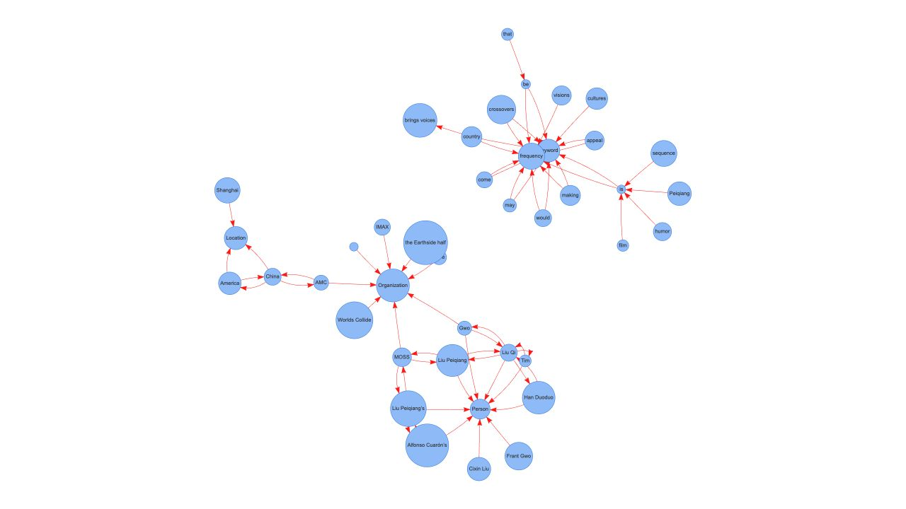

# News Graph 全面审查（2026-08-31）

审查基线：`5546a60`（2020-06-08）；主要功能代码来自 2019 年。范围覆盖全部四个 Python 文件、生成的 HTML、随仓库分发的可视化资源、README、许可证和工程配置。本次只新增审查文档和截图，没有修改业务代码、原示例输出、系统 Python 或用户原有 uv。

**结论与建议顺序**

这个项目仍适合保留为一个轻量的“英文新闻文本 → 信息抽取 → 本地图表”工具，不需要先改成大型 Web 应用。优先解决结果正确性，然后建立可复现的 Python/uv 环境，最后改进图表的信息表达和交互。

最影响价值的问题不是代码年代，而是关键词只来自最后一句、实体漏收、否定关系失真，以及把分类、共现、主谓关系混画为同一种箭头。换新依赖不会自动修复这些问题。

建议技术基线：Python **3.14.7**、spaCy **3.8.16**、与之兼容且已验证的 `en_core_web_lg==3.8.0`；使用 `pyproject.toml` + `uv.lock` + `.python-version`。当前稳定 Python 分支是 3.14，3.15 仍为预发布，暂不作为默认环境。[Python 发布状态](https://www.python.org/downloads/)、[spaCy 发布与 wheel](https://pypi.org/project/spacy/)、[模型版本](https://github.com/explosion/spacy-models/releases/tag/en_core_web_lg-3.8.0)。

**已经做过的验证**

| 检查 | 实际结果与边界 |
| --- | --- |
| Git 与文件检查 | 初始工作区干净；没有依赖清单、Python 版本声明、测试目录或 CI 工作流 |
| Python 语法 | 四个 Python 文件均可解析；并非 Python 2 项目，不需要机械语法迁移 |
| 环境安装 | 在临时目录安装 uv 0.12.7、CPython 3.14.7、spaCy 3.8.16 和原项目使用的大模型 3.8.0，macOS ARM64 安装成功 |
| 三个真实示例 | 三篇文章的抽取管线均运行成功；用内存接收输出，避免覆盖仓库中的 HTML |
| 原入口执行 | 额外直接执行未修改的 `main.py`，在临时目录生成 5,135 字节的 `graph_show.html` |
| uv 项目解析与同步 | 临时项目使用上述 Python/spaCy/模型组合，`uv lock` 和 `uv sync --locked` 均成功；模型来自固定官方 wheel URL，进入锁文件并完成安装 |
| 浏览器 | 在 1280 × 720 视口打开仓库原 HTML，画布实际为 1264 × 704；本次读取的控制台无 error/warn |
| 小样例复现 | 确认末句统计、实体漏收、否定丢失、被动语态错误、多词实体截断、分隔符崩溃、共现双向重复、单候选词无关键词 |
| Ruff | 显式使用 `E4,E7,E9,F` 检查，发现 3 项未使用变量/导入；没有自动修复或格式化 |
| 依赖漏洞 | 对临时候选环境的 66 个可查询 PyPI 包，pip-audit 未查到已知漏洞；模型包不在 PyPI，被跳过。没有可还原的旧锁文件，因此不能据此宣称历史环境或整个工具安全 |
| README 截图链接 | GitHub 图片返回 200；两个新浪图床链接在本机 10 秒 HEAD 请求内超时，不能据此断言永久失效 |

这些结果仅证明该组合在本机安装和运行可行，不等于抽取质量合格，也不等于已经验证 Linux、Windows、其他 Python 版本或大规模输入。

三篇示例在模型已加载后的单次测量如下。计时包含抽取和构造事件，不含写 HTML；不是严格的性能基准，不用于声称新版本更快。

| 示例 | 字符数 | 抽取时间 | 事件数 | 去重后节点数 |
| --- | ---: | ---: | ---: | ---: |
| 《流浪地球》 | 9,604 | 0.534 秒 | 60 | 34 |
| 东京马拉松 | 5,983 | 0.351 秒 | 73 | 34 |
| 代码作者识别 | 8,340 | 0.479 秒 | 67 | 32 |

**优先修复的代码问题**

P1 表示直接影响结果、可靠运行或安全边界；P2 表示质量、性能、可维护性改进。工作量是修改与针对性验证的粗估，不含整套界面开发。

| 优先级 | 问题及位置 | 影响 | 建议与验收 | 粗估 |
| --- | --- | --- | --- | --- |
| P1 | `news_graph.py:178` 每句覆盖 `words_postags`，后续在 194、206 行统计 | 关键词、词频只来自最后一句；基于关键词筛选的关系也一起偏向末句 | 全文累计候选词；TextRank 建边保留句界，避免修复后把相邻两句的词误认为共现。两句文本必须同时贡献统计 | 小 |
| P1 | `news_graph.py:184`—191 将实体收集放在“成功抽出关系”之后 | 独立实体、标题、名词短语中的 PERSON/ORG/GPE 被漏掉 | NER 收集独立于关系抽取；`Apple and Google.` 必须留下两个 ORG 节点 | 小 |
| P1 | `news_graph.py:115`—131 只保留主体单词和“动词+宾语”字符串 | 否定丢失、被动语态误读、多词实体截断；关系不能作为可靠事实 | 分开保存 subject/predicate/object、否定信息、原句；未支持的句式宁可不输出事实边。先覆盖主动、否定、被动、多词实体、并列宾语 | 中至大 |
| P1 | `graph_show.py:88` 用 Python `str()` 和连续字符串替换生成内联脚本 | 不可信标签中的 `</script>` 可突破脚本边界；标签 `data_edges` 会被二次替换成边数据 | JSON 序列化，并针对 HTML 内联上下文转义 `<` 等字符；避免二次替换数据内容；用恶意标签与占位符同名标签验证 | 小至中 |
| P1 | `news_graph.py:45,156,216`—224 用 `/`、`@` 拼装再拆分实体 | 合法名称包含分隔符时可崩溃或串错关系 | 实体和实体对用 tuple/结构化字段表示；带 `/`、`@` 的名称必须完整往返 | 小 |
| P1 | 仓库缺少安装、模型、版本与锁定配置 | README 示例无法在干净环境直接运行；旧结果无法复现 | 补 Python 与 spaCy/模型声明，提交 uv.lock，CI 从干净环境同步并生成示例 | 中 |
| P2 | `news_graph.py:147`—156 枚举有序对；223—224 丢掉频次 | 同一共现画 A→B 和 B→A 两条边，出现一次和多次无法区分 | 每句使用排序后的无序组合；跨句累计 count；默认无箭头，用线宽表示次数 | 小 |
| P2 | `news_graph.py:181` 在全文处理后重新处理每句话 | 重复运行完整 NLP 管线，还混用第二次 NER 与第一次 `sent.ents` | 复用一次全文分析得到的 Span/Token/实体；必要时按实体 span 归属句子。两句输入只应调用一次 NLP | 小 |
| P2 | `news_graph.py:8` 导入时加载固定大模型 | 导入就占用模型资源；缺少模型时连模块导入和轻量测试也失败 | 构造分析器时再加载，允许传入已加载的 pipeline；给出明确的缺模型提示 | 小至中 |
| P2 | `graph_show.py:64,70,78` 用显示文字作为唯一身份，统一分组、空边标签 | 同名异类节点被合并，关系性质无法分辨，分类节点主导布局 | 稳定节点 ID 与显示文字分离；至少区分实体类型与关键词，边保存 kind、count、证据 | 中 |
| P2 | `graph_show.py:87` 固定写 CWD；资源地址也相对 CWD | 总覆盖同一文件；换目录运行或只分享 HTML 时找不到 VIS；未显式指定 UTF-8 | 参数化输出路径、明确覆盖策略、UTF-8；输出附带资源或做离线单文件 HTML | 小至中 |
| P2 | `textrank.py:66`—85 只通过边创建节点 | 只有一个有效候选词时返回空；没有停用词和词形归一 | 保留孤立候选；基于 lemma 统计并保留显示形式；补短文本用例，再测关键词质量 | 中 |
| P2 | `textrank.py:30`—54 只比较权重总和收敛，所谓 min-max 的最小值从 0 开始 | 停止条件不能直接保证每个节点稳定；归一化与注释不一致 | 比较逐节点变化的范数；明确缩放定义，与小型已知图结果核对 | 中 |
| P2 | `news_graph.py:34`—38 无条件删除括号内容 | 例文中的人名、国籍、组织等线索在抽取前就被删除 | 默认保留括号信息；保留原文供证据显示，不要把清洗后的偏移直接当原文偏移 | 小 |
| P2 | `main.py:117`、`NewsMining.main()` 耦合分析与文件写入 | 导入演示模块会执行；正常输入返回 None、空输入返回 []，难以集成与测试 | 演示使用主入口保护；分析返回统一结构，渲染单独写文件；保留原 API 兼容包装 | 中 |

HTML 注入验证直接针对 `GraphShow` 的标签输入边界：单个 `</script><script>…</script>` 标签被 HTML 解析器识别为额外脚本元素。这证明导出器不应接收未转义的不可信标签；本次没有证明该完整字符串能通过所有 spaCy 抽取步骤，也没有在外部站点执行攻击。

**能直接观察到的错误结果**

| 输入或场景 | 当前输出 | 应有行为 |
| --- | --- | --- |
| `Apple builds computers. Google develops software.` | 关键词只有 software、develops、Google；NLP 调用 3 次 | 统计覆盖两句；复用一次全文 NLP |
| `Apple and Google.` | 模型识别出两个 ORG，但输出仅保留关键词/词频，不保留组织类型和实体共现 | 实体是否存在不依赖 SVO 是否成功 |
| `Acme did not acquire Beta.` | `Acme → acquire Beta` | 标记否定，不能表示为肯定收购关系 |
| `Beta was acquired by Acme.` | `Beta → acquired` 和 `by → acquired` | 正确处理施事/受事；不支持时不生成此类事实边 |
| `New York supports Apple.` | `York → supports Apple` | 保留完整的 New York 实体 |
| 受控 spaCy Doc 中的 `AC/DC`（ORG） | `KeyError('DC')` | 名称中的 `/` 不参与协议解析；这个用例验证数据管线，不依赖模型恰好识别出该实体 |
| 两句均含 Apple、Google | 两个方向各 count=2，随后 count 被丢掉 | 一条无向共现边，count=2 |
| TextRank 仅收到 `Apple/PROPN` | 无关键词 | 返回 Apple 或明确约定短文本退化策略 |

最能说明实际影响的是第三篇新闻：最后一句是“文章更新说明”，实际关键词就变成了 `Updated`、`US`、`Army`、`Research`、`Laboratory` 等，而不是正文主题“代码作者识别”。

**可视化改进方案**

下图是仓库原有 `graph_show.html` 的浏览器实拍，未重新生成或美化：



原图数据有 41 个节点、66 条边，所有节点都属于 `Event` 分组，所有边标签都是空字符串，其中有 10 对互为反向的节点连线，以及一个纯空白节点。采用 `shape: 'circle'` 而没有统计值映射，节点大小主要受标签长度影响，不能代表新闻重要程度。

第一轮建议继续输出本地静态 HTML，把界面组织为“筛选工具栏 + 实体关系图 + 证据侧栏”；关键词、词频单独展示为排序列表。保留缩放拖动，同时明确边的语义。

| 维度 | 建议 |
| --- | --- |
| 图的默认内容 | 默认展示人物、组织、地点及其关系；keyword/frequency/Person 等分类标签改为属性或图例，不再作为高连接度中心节点 |
| 节点 | 类型使用稳定的颜色和形状；大小按提及次数或已明确说明的分数缩放并设置上下限；过滤空白和无效名称 |
| 共现边 | 灰色、无箭头；线宽表示同句共现次数；提示“共现不代表事实关系” |
| 抽取关系边 | 仅受支持的规则结果展示带谓词的方向边；否定单独编码并给出原句；未经校准不标注虚构的置信度百分比 |
| 原文证据 | 点击节点或边，右侧展示原句、实体类型、出现次数；可高亮对应文本，区分模型输出与原文事实 |
| 降低拥挤 | 搜索实体、类型筛选、最小共现次数、Top-N；点击后聚焦一跳邻居；弱边默认隐藏或淡化 |
| 布局 | 固定随机种子、稳定的节点/边排序；布局稳定后停止物理模拟，提供重新布局/恢复全图按钮 |
| 阅读性 | `dot` 配合外置短标签，长名称在详情中完整显示；重要节点优先显示标签，避免满屏红箭头 |
| 可访问性 | 图例与文本列表、键盘可操作的搜索和筛选、颜色以外的区分方式；移动端详情面板上下排列 |
| 导出 | 保留离线 HTML；增加结构化 JSON、关系 CSV，图片导出作为后续便利功能 |

当前捆绑的是 **vis.js 4.8.2（2015-09-14）**，加载了约 1.5 MiB 的未压缩总包；整个 VIS 目录还包含压缩包、CSS 和 sourcemap。第一选择是迁移到专注网络图的 **vis-network**，而不是立刻引入 React 或重写为自研 D3。官方发布页当前列出 10.1.2；现有 Network/DataSet 思路可延续，但跨大版本仍需验证 options、资源加载、事件与截图表现。[vis-network 发布记录](https://github.com/visjs/vis-network/releases)、[Network 官方文档](https://visjs.github.io/vis-network/docs/network/)。

保留版本固定的本地静态资源和第三方许可证即可实现离线分发；不建议直接改为无版本 CDN 地址。若以后确有复杂图算法或数万节点需求，再基于基准选择其他引擎。目前每篇几十个节点，没有证据支持先引入图数据库、WebGL 管线或前端构建平台。

**Python 与 uv 迁移细节**

本机默认 `python3` 是 3.9.6，但仓库没有声明自身原先支持的 Python 版本，不能把系统版本当作项目版本。本机原 uv 为 0.9.11；本次只在临时目录安装更新版本以验证，没有替换用户的安装。

迁移时分别管理四件事：Python 解释器、Python 依赖、spaCy 模型、前端资源。uv 能管理前两者，也能把模型 wheel 作为 URL 依赖锁定；它不会替你管理手工拷贝的 JS 文件。

下面是与临时解析实验使用相同关键约束的建议配置，**尚未应用到仓库**：

```toml
[project]
name = "news-graph"
version = "0.1.0"
requires-python = ">=3.14,<3.15"
dependencies = [
  "spacy>=3.8.16,<3.9",
  "en-core-web-lg==3.8.0",
]

[tool.uv.sources]
en-core-web-lg = { url = "https://github.com/explosion/spacy-models/releases/download/en_core_web_lg-3.8.0/en_core_web_lg-3.8.0-py3-none-any.whl" }

[dependency-groups]
dev = ["pytest", "ruff", "pip-audit"]
```

这里将首批支持范围限定为已实测的 3.14；通过 3.13 或未来 3.15 的完整验证后，再扩展范围，不是要求永久锁死某一小版本。保留 lg 模型是为了减少同时变化的因素；比较质量后再决定是否默认改用更轻的模型。

模型也必须参与锁定。单独写一条 `python -m spacy download ...` 虽然常见，但如果模型没有声明在项目依赖里，就无法由 `uv.lock` 完整复现，后续精确同步还可能移除环境里未声明的包。官方说明模型可作为普通 Python 包安装，uv 支持 URL 依赖。[spaCy 模型安装](https://spacy.io/usage/models)、[uv 依赖管理](https://docs.astral.sh/uv/concepts/projects/dependencies/)、[uv 同步语义](https://docs.astral.sh/uv/reference/cli/)。

实施后的维护命令建议如下；现在仓库还没有 pyproject 和 tests，不能把这段当作当前可用的快速开始：

```sh
uv python pin 3.14.7
uv lock
uv sync --locked
uv run --locked pytest
uv run --locked ruff check .
uv run --locked ruff format --check .
```

提交 `pyproject.toml`、`uv.lock`、`.python-version`，忽略 `.venv/`、工具缓存和临时输出；不要忽略 uv.lock。固定开发/CI 使用的 uv 版本，按计划更新依赖并跑回归，避免每次安装隐式追随最新模型。CI 使用 `uv sync --locked` 检查配置和锁文件是否一致。[uv 项目文件](https://docs.astral.sh/uv/concepts/projects/layout/)、[uv GitHub Actions 指南](https://docs.astral.sh/uv/guides/integration/github/)。

未来如果要把工具发布成 Python 包，再补 build-system、包内模板/资源与入口。当前仅做本地应用时，不需要为迁移 uv 就立即移动全部文件。

**架构、性能与抽取质量**

保持现有三个主要职责即可：文本分析、关键词计算、图表导出。最有价值的接口调整是让分析返回结构化结果，让渲染消费结果；不需要插件系统、抽象工厂或数据库。

建议结果至少包含节点 `id/label/type/mention_count`、边 `source/target/kind/predicate/count/evidence`，以及模型版本、抽取规则版本等少量可追溯信息。字段按实际边类型使用，不要求每条边都有谓词和次数。同名实体的合并策略要保守，不能随意把简称或不同类型的实体认作同一对象。

性能上先去掉每句重复 `nlp()`，然后按需把 `build_parse_chile_dict()` 的句内双重扫描改为使用 token children 或一次遍历索引。当前单篇运行时间并不高，不应先投入多进程和缓存平台。批量文章需求出现时再采用 `nlp.pipe()`，并测量批量吞吐和内存。[spaCy 管线与批处理](https://spacy.io/usage/processing-pipelines)。

首个测试进程中导入并加载 lg 模型共耗时约 14.9 秒；这包括首次包导入，不能全部归因于模型，也不能当作稳定启动耗时。lg wheel 本次下载约 382 MiB。可比较 sm 与 lg 的启动、内存和真实抽取质量；代码没有直接调用向量相似度，但不能因此断言小模型抽取质量等价。[英文模型说明](https://spacy.io/models/en)。

目前只使用英文模型及英文依存规则，README 应明确“英文输入”。若未来支持中文或日文，需要同时考虑语言模型、分词、实体类别、依存规则和评估样例，不能只换模型名就承诺多语种支持。

TextRank 不需要立即换成大模型。先修好全文统计、停用词、lemma、多词短语和短文本处理，再用一小批人工标注文章衡量关键词 Precision@K、实体与关系准确率/召回率。数据集规模和验收门槛应基于用途约定；没有标注集时，不声称模型升级提高了准确率。

`conll_syntax()`、`textrank.py` 的 `sys` 导入，以及 `words/postags` 中间变量等有清理空间；这类工作优先级低于结果修复，且本次没有删除。`OBJECTS` 和共现实体使用 set 的遍历也影响输出顺序，涉及业务选择时应定义稳定顺序，而不只是固定图形布局种子。

**测试与工程保障**

第一批测试应围绕真实行为，不追求形式上的高覆盖率：

1. 空文本、纯空白、单词、单句与多句；不同句子均进入统计，不跨句创建关键词窗口边。
2. 没有可抽取关系的实体句；实体收集不受 SVO 成败影响。
3. 主动、否定、被动、多词实体、并列宾语；特别防止把“不收购”变成“收购”。
4. 同句实体去重、无向共现合并、跨句权重、重复事件、同名异类实体、分隔符名称。
5. 带引号、Unicode、换行、`</script>` 和占位符文字的标签，验证完整数据往返及无脚本执行。
6. 任意输出目录、资源可访问性、覆盖行为和离线打开；新生成的 HTML 与 JSON 数据一致。
7. 固定小型图的 TextRank 排序、收敛、孤立节点和稳定输出。
8. 不依赖大模型的规则/渲染单测，与固定真实模型的少量集成测试分开；模型升级必须跑集成测试。

CI 初期只需 Ruff + pytest + 一次真实模型示例生成；首批支持的操作系统至少做安装和输出冒烟验证。后续增加依赖更新 PR 和漏洞扫描，固定第三方 Actions 的提交版本。当前没有旧依赖锁文件或原环境，不宜把“升级前后截图完全相同”当作正确性标准。

**文档和示例需要补什么**

| 项目 | 改进内容 |
| --- | --- |
| README 开头 | 用两三句话说明输入是英文新闻文本，输出是什么，以及“关系抽取是规则/模型推断，共现不等于事实” |
| 快速开始 | 从安装 uv、同步 Python/依赖/模型，到运行样例和打开图表，提供可从空环境复制执行的命令 |
| 文件名 | README 说生成 `graph.html`，实际为 `graph_show.html`，必须统一 |
| API/CLI | 说明返回值、输出路径、模型选择；可先用标准库 argparse 支持文本文件或 stdin，不必引入服务框架 |
| 示例组织 | 把三篇大段文章从入口脚本移到 examples；入口只保留运行代码和主入口保护 |
| 图表说明 | 图例、节点大小、线宽、箭头、否定、筛选、证据面板的含义，避免用户猜测 |
| 截图 | 使用仓库内小尺寸截图，注明模型/版本；两个旧图床链接本次超时，避免关键文档依赖外链 |
| 限制与排错 | 英文限定、指代消解未支持、NER 歧义、模型首次下载较大、缺模型错误、离线资源和目录问题 |
| 文案 | 修正 extration / visilization / chanllenge / peoject 等拼写，以及第 27 行多出的 `)` |
| 贡献说明 | 如何运行检查、增加回归样例、更新锁文件和前端资源；增加简短变更记录 |
| 许可证与来源 | 保留现有 MIT 许可证、TextGrapher 致谢及第三方 vis 许可；示例文章记录作者/链接/用途，发布时优先使用自行撰写的短样例。此处未作转载权属判断 |

**建议分四轮实施**

以下为粗略工作量，假设继续保留英文、本地静态 HTML、不增加服务端；是规划区间，不是交付承诺。

| 轮次 | 范围 | 验收标准 | 工作量 |
| --- | --- | --- | --- |
| 1：可靠基础 | 固定 Python/spaCy/模型与 uv；加入核心回归；修全文统计、实体漏收、分隔符、HTML 序列化、输出路径 | 干净环境可安装；多句统计正确；恶意标签不执行；不会无意覆盖仓库示例；CI 可复现 | 1–2 天 |
| 2：可信数据 | 结构化节点与边；区分共现/关系；支持有限但准确的句式；保留否定和原句；未支持句式不画事实边 | 上述语义复现用例通过；每条抽取关系能回到原句；共现权重正确 | 2–4 天 |
| 3：可读图表 | vis-network 更新、分类视觉、过滤搜索、一跳聚焦、证据侧栏、稳定布局、离线导出 | 原三例及新短样例均可读；分类与关系不混淆；离线可用；桌面和窄屏验证 | 2–4 天 |
| 4：质量与文档 | 评估样例集、sm/lg 比较、关键词改进、完整 README、示例与贡献说明 | 有质量基线；README 可从空环境复现；明确支持范围和局限 | 1–2 天 |

不建议第一轮引入 LLM、向量库、Neo4j、React 全家桶、Docker 编排或多语言规则体系。它们都可能有后续用途，但当前问题可以用小规模、可验证的改动解决。新增外部模型服务还会改变费用与新闻内容的隐私边界，需要单独设计。
